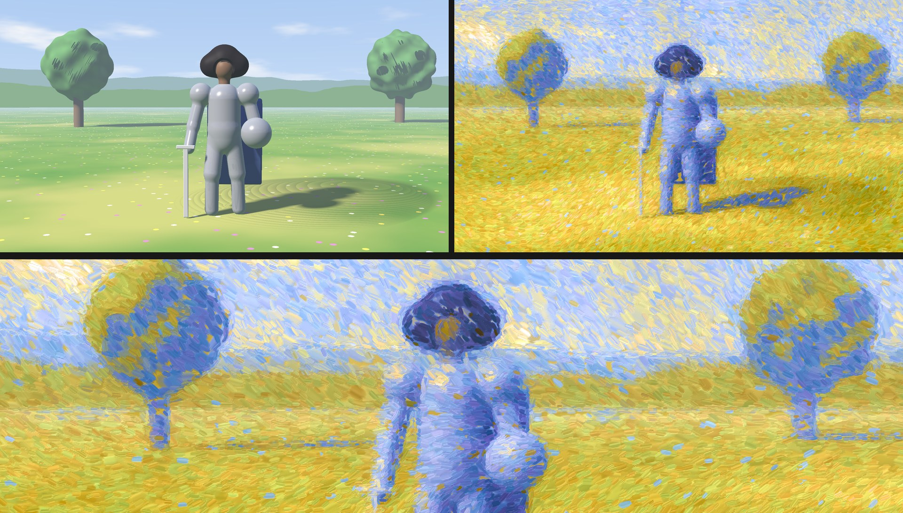

# Impressionist oil-paint shader for Godot 4

A full-screen post-process that repaints the finished frame as thick oil dabs in a
gold-and-ultramarine palette. It works on 2D and 3D games and needs no textures or
scripts.



## Setup

1. Copy this folder anywhere into your project.
2. Instance `impressionist_post.tscn` in your main scene. To cover every scene,
   add it under **Project Settings > Globals > Autoload** instead.
3. Select its `Canvas` node and tune the **Shader Parameters** in the inspector.

The scene is a `CanvasLayer` (layer 100) holding a full-rect `ColorRect` with the
shader. Everything on lower layers gets painted, HUD included. To keep the HUD
crisp, put it on a `CanvasLayer` above 100 or lower this one.

## Parameters

| Group | Parameter | What it does |
| --- | --- | --- |
| Brush | `stroke_size` | Size of the largest dabs, as a fraction of screen height. The look is the same at any resolution. |
| | `stroke_length` | How long dabs are compared to their width. |
| | `detail` | How readily small strokes are added to pick out edges and features. Raise it if characters get lost. |
| | `edge_follow` | How strongly strokes turn to run along edges. |
| | `flow_angle`, `flow_turbulence` | Resting stroke direction and how much it swirls. |
| | `bristle` | Bristle streaks and ragged stroke ends. |
| | `layers` | 3 is the full look. 2 and 1 are cheaper and looser. |
| Palette | `palette_strength` | 0 keeps your game's colours and only adds brushwork. 1 repaints entirely in the two tints. |
| | `shadow_tint`, `light_tint` | The two paints. Cool and grey things go to the first, warm and very bright things to the second. |
| | `palette_pivot` | Balance between the tints. |
| | `broken_color` | How much neighbouring dabs disagree in tint, hue and brightness. |
| | `saturation`, `black_lift` | Overall colour strength, and how far blacks are lifted so darks stay coloured. |
| Surface | `impasto` | Thickness of the paint relief. |
| | `canvas_grain` | Canvas weave. |
| | `ground_tint`, `ground_show` | Colour of the primed canvas and how much of it shows between strokes. |
| Motion | `boil_fps` | Re-randomises the strokes this many times a second. |
| | `canvas_offset` | Slides the stroke pattern (see below). |
| Advanced | `linear_input` | Turn on if the viewport has **HDR 2D** enabled. |

For a different mood, change the two tints: teal and orange for dusk, grey-violet
and pale pink for fog.

## Motion

Strokes are fixed to the screen by default, so when the camera moves the picture
slides underneath them and the brushwork shimmers. Two ways to deal with that:

- **2D games:** pin the strokes to the world by attaching this to the `Canvas` node.

  ```gdscript
  extends ColorRect

  func _process(_delta: float) -> void:
  	var cam := get_viewport().get_camera_2d()
  	if cam:
  		var h := get_viewport().get_visible_rect().size.y
  		material.set_shader_parameter("canvas_offset", cam.get_screen_center_position() * cam.zoom / h)
  ```

- **3D games:** strokes cannot follow the world. Setting `boil_fps` to 6-10 makes
  them repaint like hand-painted animation frames, which hides the sliding.

## Compatibility and cost

Checked in Godot 4.7.2 on the Compatibility, Mobile and Forward+ renderers. It
should work on any 4.x release.

This is a heavy pass: each pixel tests up to 27 dabs and reads the screen up to 82
times. It has only been run on a software rasteriser, so there are no real GPU
timings. If it costs too much, lower `layers` first.
